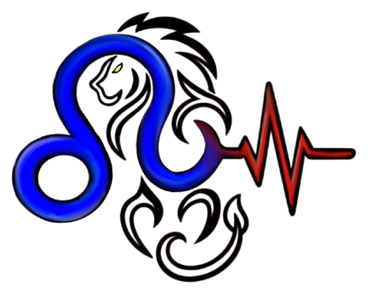

<!--
SI-METADATA
project: Z.O.S.M.A. — Deep-Space Astronaut Health Monitoring System
challenge: NASA Space Apps Challenge 2026 — Create Health Monitoring Software for Astronauts on Space Missions
si_assisted: true
si_tools: OpenClaw agent workspace (AEGIS-Med Architect persona) + LLM code assistants (Gemini / Claude); Claude (Anthropic) for initial README draft
si_generated_scope: code scaffolding, refactoring, docstrings, bilingual UI strings (ui/i18n.py), demo/synthetic data generators, desktop packaging scripts (packaging/), README.md & README.zh-TW.md
human_owned_scope: problem framing, 3-layer decision model concept, module division (6 roles), threshold selection & literature verification, final review
-->

<p align="center">
  
</p>

# Z.O.S.M.A. — Zero-gravity Operational Support & Medical Agent

**Deep-Space Astronaut Health Monitoring System · Flight Surgeon HUD**

> **Language:** English | [繁體中文 (`README.zh-TW.md`)](README.zh-TW.md)
>
> **NASA Space Apps Challenge 2026** · Challenge: [Create Health Monitoring Software for Astronauts on Space Missions](https://www.spaceappschallenge.org/2026/challenges/health-monitoring-software/?tab=details)

| Item | Link |
|---|---|
| Source Code (GitHub, Public) | https://github.com/louis71803/ZOSMA |
| License | MIT License (see [`LICENSE`](LICENSE)) |

---

## 1. Detailed Project Description

### 1.1 Problem Statement

On long-duration lunar (Artemis) and Mars missions, one-way communication delays between spacecraft and Earth reach several minutes to over 20 minutes, preventing ground-based Flight Surgeons from interpreting every physiological stream in real time. Microgravity, cosmic radiation, and closed-cabin environments simultaneously degrade musculoskeletal, cardiovascular, neuro-ocular/vestibular, and immune/metabolic systems—and these hazards compound across domains (for example, elevated cabin $\text{CO}_2$ accelerates Spaceflight-Associated Neuro-ocular Syndrome [SANS] optic disc edema, while Solar Particle Events [SPE] acutely suppress lymphocyte counts).

**Z.O.S.M.A.** is a **100% offline-capable onboard medical decision-support system** that translates continuous habitat telemetry and crew self-check-in measurements into intuitive **GREEN / YELLOW / RED** traffic-light diagnostics, jargon-free physiological explanations, and step-by-step operational countermeasures. It automatically generates closed-loop **Short-Term Triage (0–48 h)** and **Long-Term Regimen & Trend Forecasts (7–30 d)** so crew members without a medical background can autonomously monitor, triage, and mitigate health risks in deep space.

### 1.2 How It Works

```
Sensor CSV / JSON Streams ──┐
HUD Manual Inputs & Check-in┼─► core/data_loader.py ─► 5 Domain Modules evaluate()
NASA OSDR Real Datasets ────┘                               │
                                                            ▼
                  Layer 0 QC Gate → Layer 1 Fixed Rules → Layer 2 Personal Baseline → Layer 3 Trend Projection
                                                            │ (Worst Result Wins)
                                                            ▼
                                  core/schema.py (Pydantic Unified Data Contract)
                                                            ▼
                                  core/scheduler.py (Cross-Module Safety Arbitration + Planner)
                                                            ▼
                      Streamlit + Bespoke HTML/SVG SpaceX HUD / Native PyWebView Desktop App (.exe)
```

**4-Stage Decision Engine (Applied to Every Indicator)**

| Layer | Logic |
|---|---|
| **Layer 0 — Quality Gatekeeper** | Validates sensor SNR, missing fields, and physiological plausibility (e.g., ECG lead quality, motion artifact $g$, Mini OCT scan quality & baseline registration, GOES telemetry staleness $>30\text{ min}$). Bad readings trigger an immediate re-scan prompt instead of false clinical alarms. |
| **Layer 1 — Fixed Clinical / NASA Rules** | Enforces NASA-STD-3001 and aerospace clinical thresholds (e.g., $\text{ppCO}_2\ 2.5 / 3.0\text{ mmHg}$, cumulative career radiation $480 / 600\text{ mSv}$, GOES $\ge 10\text{ MeV}$ proton flux $10 / 100\text{ pfu}$). |
| **Layer 2 — Personal Pre-Flight Baseline** | Evaluates intra-subject deviation against each crew member's pre-flight baseline ($\pm 2\text{ SD}$ or percentage change $\Delta\%$). |
| **Layer 3 — Trend Slope & Time-to-Red** | Fits recent longitudinal slope ($dY/dt$) to project `days_until_red_prediction`, proactively escalating a metric to **YELLOW** before it crosses the red clinical threshold (*Worst Result Wins*). |

**Five Domain Evaluator Modules (`modules/`)**

| Module | Monitored Indicators (Summary) |
|---|---|
| **Musculoskeletal** `musculoskeletal` | E4D Bone Stimulus Index ($S_{\text{bone}}$), Isometric Peak Force (SRI $\Delta\text{Strength}\%$), VBT squat velocity loss ($30\%$ red limit), Ultrasound 2 thigh ($4\%/7\%$) & calf ($5\%/10\%$) CSA, SLAMMD body mass ($5\%/10\%$), Bio-Analyzer bone turnover markers (NTX, CTX $+50\%$ red, P1NP); NASA OSD-575 Ca/ALP baseline validation; includes 87 published ISS cohort reference statistics for benchmark comparison. |
| **Cardiovascular & Aerobic** `cardiovascular` | M1–M11: Resting HR, PTT Blood Pressure, $\text{SpO}_2$, Respiratory Rate, Holter 24h PVC burden (validated against PhysioNet MIT-BIH records), Stand/LBNP orthostatic tolerance, CEVIS 150W HR drift, Ultrasound 2 GLS myocardial strain, Internal Jugular Vein (IJV) stasis/thrombus protocol, Dill & Costill plasma volume shift $\% \Delta PV$ (OSD-569), serum $\text{K}^+$ & CRP (OSD-575). |
| **Neuro-Ocular & Vestibular** `neuro_ocular` | Bilateral (OD/OS) SANS & vestibular evaluation: Mini OCT QC, Total Retinal Thickness $\Delta\text{TRT}$ ($+20 / +55\text{ }\mu\text{m}$), Optic Nerve Head volume $\Delta V_{\text{ONH}}$, RNFL thickening, hyperopic shift ($\ge +0.75\text{ D} \rightarrow$ Space Anticipation Glasses), choroidal folds / Amsler scotoma, combined ONSD ($>6.0\text{ mm}$ & $\Delta \ge +0.5\text{ mm}$); gravity-transition-aware VOR gain, OCR degrees, motion sickness score, and tandem walk. |
| **Immune, Endocrine & Metabolic** `immune_metabolic` | I1–I10: Oral temperature & 9 symptom checklist, WBC & $<10\%$ neutrophil mis-sort quality gate (validated on OSD-569), lymphocyte depression ($-25\%$ & post-SPE $-50\%$ rule), neutrophil count & NLR stress index, salivary VZV/EBV viral reactivation copies/mL, sleep & stress load, CRP/IL-6, Vitamin D3 & renal stone hydration guard. |
| **Radiation, Acoustics & Cabin Env** `cabin_environment` | 17 NASA-STD-3001 cards: `RAD-01..03` (DOSTEL area dose rate with South Atlantic Anomaly [SAA] masking, personal cumulative dose, NOAA GOES-18 proton flux), `ACO-01..03` (module SPL NC curves, LEQ8 noise dose, OOHA audiogram), `ATM-01..07` ($\text{ppCO}_2$ with $\ge 24\text{ h}$ stuck-sensor check, total cabin pressure & rapid depressurization fast-track, $T/\text{RH}$ comfort envelope, VOC/ammonia SMAC ratios, potable water TOC/iodine, microbial & particulate limits), `ISO-01..04` (Actiwatch sleep, PVT-B alertness, Bedford workload, circadian lighting). |

**Cross-Module Medical Safety Arbitration (`core/scheduler.py`)**

- `HALT_HEAVY_EXERCISE_ON_CARDIO_OR_IMMUNE_RED`: Automatically suspends heavy E4D resistance workouts and high-intensity CEVIS intervals whenever Cardiovascular or Immune triggers a `RED` alert (fever, arrhythmia, or suspected IJV thrombus).
- `SPE_SHELTER_AND_48H_LYMPHOCYTE_CHECK`: Propagates Solar Particle Event alerts from Module 6 to enforce immediate radiation shelter entry and schedules a mandatory 48-hour post-SPE lymphocyte count check in Module 5.
- `CO2_SANS_SYNERGY_MITIGATION`: Coordinates environmental $\text{CO}_2$ scrubbing with Module 4 SANS ocular monitoring when cabin $\text{ppCO}_2$ rises.

**Key System Capabilities**

- **Day-1 Cold-Start (`day1_standby`) vs. Day-124 Showcase Dataset (`day124_showcase`)**: Environmental telemetry comes online immediately at Mission Day 1, while crew physiological modules remain in `STANDBY` until initial check-ins are logged—preventing false alarms before baseline acquisition. Evaluators and judges can switch to the full Day-124 mission showcase dataset with one click.
- **Multi-Crew Profiles & Offline Spacecraft RTC**: Per-astronaut persistent records (`data/crew_records/<crew_id>.json`) paired with an offline Mission Control Real-Time Clock that tracks Mission Sol/Day and measurement countdowns.
- **Zero-Medical-Background 3-Step Crew Guidance**: Every indicator provides (1) *How to Measure*, (2) *What It Means in Plain Language*, and (3) *Actionable Protocol*.
- **Data Provenance Transparency**: Every metric explicitly displays whether it is driven by `REAL` agency/uploaded files or `SIMULATED` fallback payloads.
- **Longitudinal History Backfill (`core/history_completer.py`)**: Extracts multi-row time series from loaded CSV/JSON files (GOES proton flux, cabin pressure/$\text{O}_2$, thermal/humidity, microbial counts, E4D sets) to render 3-Layer Trajectory Charts:
  - *Flight Mode*: Indicators with $<2$ historical points are never padded with fake curves; the HUD honestly reports single-point status.
  - *Developer Mode*: Optionally synthesizes smooth `[D0, D30, D60, D90, Current]` stress-test trajectories tagged with `synthetic_completed=True` and a visible `DEV Synthetic History` badge.
- **Bilingual SpaceX-Style HUD**: Instant toggle between **English** and **繁體中文 (Traditional Chinese)**.
- **Standalone Windows Desktop App (`ZOSMA.exe`)**: Packaged via PyInstaller (`--onedir`) + `pywebview` (Edge WebView2) so judges and end users can launch the native HUD window directly without installing Python or Conda environments.

### 1.3 Benefits & Impact

- **Deep-Space Autonomy**: Enables immediate onboard clinical triage during communication blackouts or Mars transit latency.
- **Proactive Early Warning**: Trend slope projection warns crew *days before* physiological drift reaches dangerous clinical limits.
- **Low False-Alarm Fatigue**: Layer 0 QC gatekeeping and Day-1 STANDBY masking prevent corrupted sensor packets from triggering panic.
- **Holistic Systems View**: Integrates environmental hazards and 4 human physiological systems on one screen with automated cross-domain conflict resolution.
- **Full Scientific Traceability**: Thresholds are mapped to NASA-STD-3001 clauses, NASA NTRS technical briefs, and peer-reviewed space medicine literature.

> ⚠️ **Medical Disclaimer:** This software is a hackathon research prototype and is **not** a certified medical device. All status lights and protocols are for demonstration and educational purposes only. Except where explicitly marked `REAL` (NASA OSDR / NOAA GOES / PhysioNet), crew profiles are synthetic simulations and do not represent identifiable astronauts.

### 1.4 Tools, Coding Languages, Hardware & Software

| Category | Stack |
|---|---|
| **Languages** | Python 3.10+; Frontend HUD built with bespoke HTML5 / CSS3 / Interactive SVG / ES6 JavaScript |
| **Runtime Environment** | Conda (Python 3.10+) on Windows; also buildable as a standalone Windows desktop app (`ZOSMA.exe`) |
| **Core Python Libraries** | `streamlit>=1.38.0` (with bidirectional `st.components.v2` bridge & `Pillow` for favicon/assets), `plotly>=5.24.0`, `pydantic>=2.9.0`, `pandas>=2.2.0`, `numpy>=1.26.0`, `scipy>=1.14.0`, `matplotlib>=3.9.0`, `pyyaml>=6.0.1` |
| **Desktop Packaging** | `PyInstaller>=6.0` + `pywebview` (Edge WebView2 native window) via `packaging/launcher.py` & `packaging/zosma.spec` |
| **Development Tools** | Git / GitHub (`main` + `feat/*` zero-conflict branch structure), VS Code, OpenClaw agent workspace |
| **Hardware Emulated** | Software-only; emulates telemetry formats of ISS onboard hardware (Bio-Monitor, Holter, Ultrasound 2, Mini OCT, E4D, CEVIS, SLAMMD, HemoCue/Bio-Analyzer, RadLab DOSTEL, AQM, Actiwatch) |

### 1.5 Repository Structure

```text
app.py                 # Streamlit entrypoint & bidirectional HUD state bridge (Role 1)
core/                  # Pydantic schema, data loader, cross-module scheduler, check-in tracker,
                       # multi-crew store, Day-1 onboarding mask, and history completer
modules/               # 5 domain module entrypoints + helper packages (cardio/, cabin_env/)
ui/                    # Glassmorphism CSS, EN/ZH i18n corpus, interactive anatomy/habitat SVGs,
                       # HUD client controller, slide-over telemetry drawer, and onboarding bar
ui/assets/             # Cropped transparent project logo (zosma_logo.png) & square favicon
data/                  # Per-module CSV/JSON folders + shared_real/ (NASA OSDR datasets)
packaging/             # Native Windows .exe launcher (pywebview), PyInstaller spec, icon, & sync script
```

### 1.6 Installation & Running

#### Option A — Run Standalone Windows Desktop App (No Python / Conda Required)

If using the pre-built release folder (`dist/ZOSMA_HUD/`):
1. Double-click **`ZOSMA.exe`** to open the native Z.O.S.M.A. HUD desktop window directly.
2. To update `modules/*.py` or `data/` CSV files without rebuilding the executable, replace the files directly inside `ZOSMA_HUD/modules/` or `ZOSMA_HUD/data/`, or run `python packaging/sync_updates.py` from the developer workspace.

#### Option B — Run from Python Source (Developer Environment)

```bash
git clone https://github.com/louis71803/ZOSMA.git
cd ZOSMA
conda create -n zosma python=3.10 -y && conda activate zosma
pip install -r requirements.txt
streamlit run app.py
```

#### Option C — Build Standalone `ZOSMA.exe` from Source

```powershell
pip install pyinstaller pywebview
packaging\build_exe.bat
```

Missing CSV files never crash the application: each module provides `export_demo_csvs()` to auto-generate starter CSV templates and `demo_payload(scenario="green"|"yellow"|"red"|"bad_data")` for instant scenario simulation.

### 1.7 Team Architecture & Role Division

| Role | Team Member (Space Apps ID) | Dedicated Git Branch | Key Responsibilities & File Ownership |
|---|---|---|---|
| **Role 1 — Team Lead, System Integrator & UI Architect** | **LONG GUI HE** (`@louis71803`) | `main` | Project planning, role & authority architecture, system integration, SpaceX HUD frontend, cross-module scheduler, desktop `.exe` packaging (`app.py`, `core/*.py`, `ui/`, `packaging/`, `data/shared_real/`) |
| **Role 2 — Musculoskeletal Specialist** | **Liya Hayuningtiyas** (`@liya_hayuningtiyas`) | `feat/musculoskeletal` | Demo video lead presenter; bone & muscle loss evaluator (`modules/musculoskeletal.py`, `data/musculoskeletal/`) |
| **Role 3 — Cardiovascular & Aerobic Specialist** | **CHUA YAO JUN** (`@chuayj`) | `feat/cardiovascular` | Hand-drawn project icon & emblem design; hemodynamics, arrhythmia & IJV stasis evaluator (`modules/cardiovascular.py`, `modules/cardio/`, `data/cardiovascular/`) |
| **Role 4 — Neuro-Ocular & Vestibular Specialist** | **Hsin Ling Hu** (`@janicekokomihu`) | `feat/neuro-ocular` | Video editing & production; SANS per-eye OCT/ONSD & vestibular transition evaluator (`modules/neuro_ocular.py`, `data/neuro_ocular/`) |
| **Role 5 — Immune, Endocrine & Metabolic Specialist** | **Yehyangli** (`@yehyangli`) | `feat/immune-metabolic` | NASA literature curation & data research; hematology, viral reactivation & renal guard evaluator (`modules/immune_metabolic.py`, `data/immune_metabolic/`) |
| **Role 6 — Radiation, Acoustics & Cabin Env Specialist** | **Huang Ching Ting** (`@judysmartchef`) | `feat/cabin-env` | Demo production; 17-card NASA-STD-3001 habitat & radiation evaluator (`modules/cabin_environment.py`, `modules/cabin_env/`, `data/cabin_environment/`) |

---

## 2. References & Space Agency Partner Data

### 2.1 Space Agency & Biomedical Datasets

| Dataset | Source | Usage in Z.O.S.M.A. | Repository Path |
|---|---|---|---|
| **NASA OSDR OSD-569** — SpaceX Inspiration4 Complete Blood Count (CBC) | https://osdr.nasa.gov/bio/repo/data/studies/OSD-569 | Immune WBC/lymphocyte/neutrophil baselines & QC gate validation; Cardiovascular Hb/Hct (Dill & Costill plasma volume shift) | `data/shared_real/OSD-569_inspiration4_cbc.csv` |
| **NASA OSDR OSD-575** — Inspiration4 Comprehensive Metabolic Panel (CMP) | https://osdr.nasa.gov/bio/repo/data/studies/OSD-575 | Serum Calcium, Alkaline Phosphatase (ALP), Creatinine, and Potassium ($\text{K}^+$) baselines | `data/shared_real/OSD-575_cmp.csv` |
| **NASA OSDR OSD-575** — Cardiovascular Protein Panel (CRP, Fibrinogen) | https://osdr.nasa.gov/bio/repo/data/studies/OSD-575 | Systemic inflammation & coagulation reference | `data/shared_real/OSD-575_cv_panel.csv` |
| **NOAA SWPC GOES-18** Integral Proton Flux ($\ge 10$ / $\ge 100\text{ MeV}$, snapshot `2026-11-14`) | https://www.swpc.noaa.gov/products/goes-proton-flux | `RAD-03` Solar Particle Event (S1/S2 threshold) detection & longitudinal trajectory | `data/cabin_environment/goes_integral_protons_6h.json` |
| **NASA CCMC DONKI** (Solar Energetic Particle Events) | https://kauai.ccmc.gsfc.nasa.gov/DONKI/ | `RAD-03` SPE alert rule & cross-module protocol design reference | — |
| **PhysioNet MIT-BIH Arrhythmia Database** (Records 100, 106, 119, 208, 223) | https://physionet.org/content/mitdb/1.0.0/ | Holter 24-hour PVC burden & arrhythmia detection rule validation | `modules/cardio/cardio_data.py` |
| **PhysioNet Postural / Orthostatic Blood Pressure Reference (PRCP)** | https://physionet.org/ | Stand test orthostatic tolerance & Pulse Transit Time (PTT) calibration validation | `modules/cardio/cardio_data.py` |

### 2.2 NASA Standards & Technical Reports

- **NASA-STD-3001 Vol. 1 & Vol. 2** (*Space Flight Human-System Standard*), clauses referenced: V1-4030/4031, V1-5001, V2-5007, V2-6003/6006, V2-6004, V2-6012/6013, V2-6026, V2-6050 (SMAC), V2-6052, V2-6059, V2-6078/6079/6080, V2-6086, V2-6115 — https://www.nasa.gov/ochmo/human-spaceflight-standards/
- **NASA/SP-20250000273 (2025)** *Astronaut physiological deconditioning and exercise prescription countermeasures* — https://www.nasa.gov/wp-content/uploads/2025/02/sp-20250000273.pdf
- **NASA OCHMO-TB-030** *Bone Loss Technical Brief* — https://www.nasa.gov/wp-content/uploads/2023/12/ochmo-tb-030-bone-loss.pdf
- **NASA OCHMO-TB-031** *Exercise Overview Technical Brief* — https://www.nasa.gov/wp-content/uploads/2023/12/ochmo-tb-031-exercise-overview.pdf
- **NASA HRP** — *Risk of Spaceflight-Induced Bone Changes* — https://www.nasa.gov/reference/risk-of-spaceflight-induced-bone-changes/
- **NASA HRP** — *Risk of Reduced Cardiorespiratory and Musculoskeletal Fitness* — https://www.nasa.gov/reference/risk-of-reduced-cardiorespiratory-and-musculoskeletal-fitness/
- **NASA HRP** — *5 Hazards of Human Spaceflight* — https://www.nasa.gov/hrp/hazards/
- **NASA** — *Science in Space: Astronaut Exercise (2024)* — https://www.nasa.gov/missions/station/iss-research/astronaut-exercise/
- **NASA JSC-67378 Rev 1** *Nutritional Requirements for Exploration Missions* — https://ntrs.nasa.gov/api/citations/20205008306/downloads/JSC67378%20Expl%20Nutr%20Reqs%20042020.pdf
- **NASA NTRS 20240008204** — *Exploration Exercise System (EES) Development* — https://ntrs.nasa.gov/citations/20240008204
- **NASA NTRS 20110015001** — Rice et al., *Inadequate Loading Stimulus on ISS* — https://ntrs.nasa.gov/archive/nasa/casi.ntrs.nasa.gov/20110015001.pdf
- **NASA NTRS 20100030546** — Smith, *Calcium and Bone Metabolism During Spaceflight* — https://ntrs.nasa.gov/api/citations/20100030546/downloads/20100030546.pdf
- **NASA NTRS 20140013483** — Smith, *Bone Metabolism on ISS Missions* — https://ntrs.nasa.gov/citations/20140013483
- **NASA NTRS 20000020539** — Whitson et al., *Renal Stone Risk During Spaceflight* — https://ntrs.nasa.gov/citations/20000020539
- **NASA NTRS 20090014816** — *Nutritional Status Assessment Fact Sheet* — https://ntrs.nasa.gov/api/citations/20090014816/downloads/20090014816.pdf
- **NASA NTRS 20230004166** — Varanoske et al. (2023), *Inter-Individual Variability in Astronaut Strength* — https://ntrs.nasa.gov/citations/20230004166
- **NASA/TM-2014-218306** — Pennline & Mulugeta, *Daily Load Stimulus Formulas* — https://ntrs.nasa.gov/citations/20140012744
- **NASA NTRS 20050184836** — Smith et al. (2005), *J Bone Miner Res* 20(2):208–218 — https://ntrs.nasa.gov/citations/20050184836

### 2.3 Peer-Reviewed Literature

- Lang et al. (2004), *J Bone Miner Res* 19(6):1006–1012 — https://pubmed.ncbi.nlm.nih.gov/15125798/
- Gopalakrishnan et al. (2010), *Aviat Space Environ Med* 81:91–104 — https://pubmed.ncbi.nlm.nih.gov/20131648/
- Trappe et al. (2009), *J Appl Physiol* 106(4):1159–1168 — https://pubmed.ncbi.nlm.nih.gov/19150852/
- Sanchez-Medina & Gonzalez-Badillo (2011), *Med Sci Sports Exerc* 43(9):1725–1734 — https://pubmed.ncbi.nlm.nih.gov/21311352/
- English et al. (2015), *Aerosp Med Hum Perform* 86(12 Suppl):A68–A77 — https://pubmed.ncbi.nlm.nih.gov/26630197/
- English et al. (2020), *npj Microgravity* 6:21 (Sprint Study) — https://pmc.ncbi.nlm.nih.gov/articles/PMC7434884
- Scott et al. (2023), *npj Microgravity* 9:11 — https://pmc.ncbi.nlm.nih.gov/articles/PMC9898566
- Scott et al. (2017), *J Cachexia Sarcopenia Muscle* 8:475–481 — https://pmc.ncbi.nlm.nih.gov/articles/PMC5476852
- Zwart et al. (2014), *Aviat Space Environ Med* 85(9):897–904 — https://www.ncbi.nlm.nih.gov/pubmed/25197887
- LeBlanc et al. (2013), *Osteoporos Int* 24(7):2105–2114 — https://pubmed.ncbi.nlm.nih.gov/23334732/
- Stavnichuk et al. (2020), *npj Microgravity* 6:13 — https://pmc.ncbi.nlm.nih.gov/articles/PMC7200725
- Gabel et al. (2022), *Br J Sports Med* 56:196–203 (TBone Study) — https://d-nb.info/1251562248/34
- Dill & Costill (1974), *J Appl Physiol* 37(2):247–248 (Plasma volume shift calculation)

### 2.4 Additional Space Hardware & Reference Resources

- Canadian Space Agency — *Bio-Analyzer* — https://www.asc-csa.gc.ca/eng/iss/bio-analyzer.asp
- Danish Aerospace Company — *E4D Enhanced European Exploration Exercise Device* — https://www.danishaerospace.com/en/work/products/e4d
- Science News — *The Zero Gravity Diet* — https://www.sciencenews.org/blog/food-for-thought/zero-gravity-diet
- Space.com — *How do astronauts weigh themselves in space?* — https://www.space.com/space-exploration/human-spaceflight/how-do-astronauts-weigh-themselves-in-space
- UCSF News Release (2004) on Lang et al. — https://www.ucsf.edu/news/2004/03/97565/ucsfbaylor-team-uses-new-method-measure-bone-loss-astronauts-flying-long

Full musculoskeletal benchmark entries (87 published ISS data points with verification tags) are stored in `data/musculoskeletal/iss_published_reference.csv` and `data/musculoskeletal/literature_reference.json`.

### 2.5 Open-Source Software Libraries

| Package | License | URL |
|---|---|---|
| Streamlit | Apache-2.0 | https://github.com/streamlit/streamlit |
| Plotly.py | MIT | https://github.com/plotly/plotly.py |
| Pydantic | MIT | https://github.com/pydantic/pydantic |
| pandas | BSD-3-Clause | https://github.com/pandas-dev/pandas |
| NumPy | BSD-3-Clause | https://github.com/numpy/numpy |
| SciPy | BSD-3-Clause | https://github.com/scipy/scipy |
| Matplotlib | Matplotlib License (PSF-based) | https://github.com/matplotlib/matplotlib |
| PyYAML | MIT | https://github.com/yaml/pyyaml |
| Pillow | MIT-CMU (HPND) | https://github.com/python-pillow/Pillow |
| pywebview (Desktop Window Wrapper) | BSD-3-Clause | https://github.com/r0x0r/pywebview |
| PyInstaller (Desktop Bundler) | GPL-2.0-or-later with Bootloader Exception | https://github.com/pyinstaller/pyinstaller |

### 2.6 Visual Assets & Artwork

- Holographic human anatomy maps, habitat schematics, and SpaceX-inspired HUD styling (`ui/anatomy_svgs.py`, `ui/styles.py`) are procedurally authored in SVG/CSS by the team (with SI coding assistance; see Section 3).
- Project emblem `ui/assets/zosma_logo.png` (Leo constellation symbol + lion silhouette + ECG waveform), `ui/assets/zosma_favicon.png`, and `packaging/zosma_app.ico`: originally **hand-drawn (non-AI)** by team member **CHUA YAO JUN (`@chuayj`, Role 3)** and processed with Python `Pillow`/`NumPy` alpha-contour cleanup for HUD integration.
- The HUD visual layout takes conceptual inspiration from SpaceX Crew Dragon and NASA Mission Control displays without using any official agency or corporate logos.

### 2.7 Synthetic Data Disclosure

Except for files in `data/shared_real/` (NASA OSDR OSD-569 & OSD-575) and `data/cabin_environment/goes_integral_protons_6h.json` (NOAA GOES-18), all CSV/JSON time series and `preflight_baseline.json` files under `data/` are **synthetic datasets** parameterized from the peer-reviewed literature above and contain no personally identifiable astronaut health data. Developer Mode trajectory backfills are likewise synthetic and explicitly labeled with `synthetic_completed=True`.

---

## 3. Superintelligence (SI) / AI Usage Disclosure

This project utilized SI/AI tools during development as documented below (machine-readable metadata is also embedded in the `SI-METADATA` header at the top of this file):

| SI / AI Tool | Usage | SI-Generated Scope |
|---|---|---|
| **OpenClaw Agent Workspace** (*AEGIS-Med Architect* persona configured via `AGENTS.md` & `IDENTITY.md`, powered by Gemini / Claude LLMs) | Code scaffolding, refactoring, debugging, modular splitting, data validation, and PyInstaller desktop packaging | Code scaffolding & implementation across `core/`, `modules/`, `ui/`, and `packaging/`; docstrings; bilingual corpus in `ui/i18n.py`; `export_demo_csvs()` / `demo_payload()` synthetic generators; procedural SVG anatomy code |
| **Claude (Anthropic)** & **Gemini** | Drafting and bilingual refinement of project documentation | `README.md` & `README.zh-TW.md` |

**Human Team Original Contributions (Non-SI)**

- Core clinical & operational architecture: Onboard autonomous triage + 4-layer decision model (*Layer 0 QC Gate → Layer 1 Fixed Thresholds → Layer 2 Personal Baseline → Layer 3 Trend Projection, Worst Result Wins*).
- Division into 5 physiological/environmental domains, 6-role team workflow, and zero-conflict file ownership architecture.
- Selection of physiological thresholds and primary literature verification (`verified` status: `fetched` / `excerpt` / `user_pasted`).
- Cross-module safety arbitration rules (exercise halt on Cardio/Immune Red, SPE shelter + 48h lymphocyte check, $\text{CO}_2$–SANS synergy) and Day-1 `STANDBY` cold-start lifecycle design.
- Review, integration testing, and validation of all SI-assisted code prior to merge.

---

## 4. Final Project Links

- **GitHub Repository (Public, No Login Required)**: https://github.com/louis71803/ZOSMA
- **Standalone Windows Release (GitHub Releases)**: https://github.com/louis71803/ZOSMA/releases
- **Demo Video / Presentation Slides**: https://drive.google.com/drive/folders/14he2CVS1C9U2UCFpom2J4MjDVIIoJ0IT?usp=sharing

---

## License

MIT License © 2026 Team Z.O.S.M.A. (`louis71803`)
