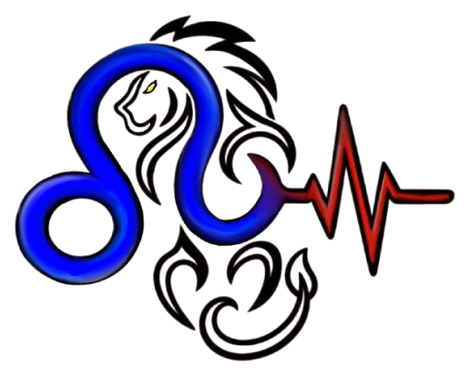

<!--
SI-METADATA
project: Z.O.S.M.A. — Deep-Space Astronaut Health Monitoring System
challenge: NASA Space Apps Challenge 2026 — Create Health Monitoring Software for Astronauts on Space Missions
si_assisted: true
si_tools: OpenClaw agent workspace (AEGIS-Med Architect persona) + LLM code assistants (Gemini / Claude); Claude (Anthropic) for initial README draft
si_generated_scope: code scaffolding, refactoring, docstrings, bilingual UI strings (ui/i18n.py), demo/synthetic data generators, desktop packaging scripts (packaging/), README.md & README.zh-TW.md
human_owned_scope: problem framing, 3-layer decision model concept, module division (6 roles), threshold selection & literature verification, final review
-->

<p align="center">
  
</p>

# Z.O.S.M.A. — Zero-gravity Operational Support & Medical Agent

**深空太空人健康監測系統 · Flight Surgeon HUD**

> **語言切換 (Language):** [English (`README.md`)](README.md) | 繁體中文
>
> **NASA Space Apps Challenge 2026** · 挑戰題目：[Create Health Monitoring Software for Astronauts on Space Missions](https://www.spaceappschallenge.org/2026/challenges/health-monitoring-software/?tab=details)

| 項目 | 連結 |
|---|---|
| 原始碼（GitHub，公開） | https://github.com/louis71803/ZOSMA |
| 授權 | MIT License（見 [`LICENSE`](LICENSE)） |

---

## 1. 專案詳細說明（Detailed Project Description）

### 1.1 要解決的問題

前往月球与火星的長期深空任務中，太空船與地面之間的單向通訊延遲可達數分鐘至 20 分鐘以上，地面航醫（Flight Surgeon）無法即時判讀每一筆生理數據。微重力、宇宙輻射、密閉艙環境會同時影響骨骼肌肉、心血管、眼睛與前庭、免疫代謝等系統，而這些風險彼此會互相加乘（例如艙內 $\text{CO}_2$ 升高會加重 SANS 視神經水腫風險、太陽質子事件 [SPE] 會急性壓抑淋巴球數量）。

Z.O.S.M.A. 是一套**可在艙上 100% 離線運作**的自主健康監測與決策支援系統：把艙內感測器與太空人每日自我量測的數據，轉成直覺的「綠／黃／紅」燈號、白話生理說明與可執行的處置步驟，並自動排出短期（0–48 小時）與長期（7–30 天）的量測與訓練計畫，讓非醫療背景的組員也能自主判讀與因應。

### 1.2 運作機制

```
感測器 CSV / JSON  ─┐
HUD 手動輸入 / 每日打卡 ─┼─► core/data_loader.py ─► 5 個領域模組 evaluate()
NASA OSDR 真實數據 ──┘                               │
                                                     ▼
                             Layer 0 品質閘門 → Layer 1 固定門檻 → Layer 2 個人基準 → Layer 3 趨勢預測
                                                     │（取最差結果 Worst Result Wins）
                                                     ▼
                             core/schema.py（Pydantic 統一輸出格式）
                                                     ▼
                             core/scheduler.py（跨模組衝突仲裁 + 排程）
                                                     ▼
                             Streamlit + 自製 HTML/SVG HUD ／ Windows 原生桌面應用 (ZOSMA.exe)
```

**四層決策模型（每個指標都經過）**

| 層級 | 內容 |
|---|---|
| Layer 0 — 品質閘門 | 檢查感測器品質、缺值、不合理數值（如 ECG 導程品質、動作雜訊、OCT 影像品質與基準對位、GOES 資料逾時 >30 分鐘）。不合格就要求重測，不發出假警報。 |
| Layer 1 — 固定門檻 | NASA-STD-3001 與臨床文獻的固定上下限（如 $\text{ppCO}_2\ 2.5 / 3.0\text{ mmHg}$、累積劑量 $480 / 600\text{ mSv}$、GOES $\ge 10\text{ MeV}$ 質子通量 $10 / 100\text{ pfu}$）。 |
| Layer 2 — 個人基準 | 與該組員發射前基準值比較（$\pm 2\text{ SD}$ 或變化百分比 $\Delta\%$）。 |
| Layer 3 — 趨勢預測 | 以近期斜率線性外推，預估「幾天後會變紅燈」（`days_until_red_prediction`），提前把綠燈升為黃燈。 |

**五大領域模組（`modules/`）**

| 模組 | 涵蓋指標（摘要） |
|---|---|
| 骨骼肌肉 `musculoskeletal` | E4D 訓練骨刺激指數、等長最大肌力、深蹲速度損失（30% 紅線）、超音波大腿／小腿截面積、SLAMMD 體重、骨代謝標記 NTX/CTX/P1NP；以 OSD-575 鈣／ALP 作血液基準參照；內含 87 筆已發表 ISS 研究統計值做對照圖。 |
| 心血管 `cardiovascular` | M1–M11：靜止心率、PTT 血壓、$\text{SpO}_2$、呼吸率、Holter 24h PVC 負荷（以 MIT-BIH 紀錄驗證）、站立耐受、CEVIS 150W 心率漂移、GLS 心肌應變、頸內靜脈（IJV）滯流／血栓、Dill & Costill 血漿容積變化（OSD-569）、血鉀／CRP（OSD-575）。 |
| 神經眼科與前庭 `neuro_ocular` | 雙眼分別評估 SANS：Mini OCT 品質、視網膜總厚度 $\Delta\text{TRT}$、視神經盤體積 $\Delta V_{\text{ONH}}$、RNFL、遠視偏移（觸發 Space Anticipation Glasses）、脈絡膜皺褶／Amsler、ONSD；重力轉換期的 VOR 增益、OCR、暈動症分數、直線行走。 |
| 免疫代謝 `immune_metabolic` | 口溫與 9 項症狀、WBC／淋巴球（$-25\%$、SPE 後 $-50\%$ 規則）、嗜中性球與 NLR、唾液 VZV/EBV 病毒再活化、睡眠與壓力、CRP/IL-6、補水與腎臟保護。 |
| 艙內環境與輻射 `cabin_environment` | 17 張 NASA-STD-3001 量測卡：RAD-01..03（DOSTEL 區域劑量並遮蔽南大西洋異常區 SAA、個人累積劑量、NOAA GOES 質子通量）、ACO-01..03（噪音 NC 曲線、LEQ8 劑量、聽力圖）、ATM-01..07（$\text{CO}_2$ 含卡住感測器偵測、艙壓與快速失壓、溫濕度、VOC/氨 SMAC 比值、飲用水、微生物、懸浮微粒）、ISO-01..04（睡眠、PVT-B 警覺度、Bedford 工作負荷、晝夜節律照明）。 |

**跨模組安全仲裁（`core/scheduler.py`）**

- `HALT_HEAVY_EXERCISE_ON_CARDIO_OR_IMMUNE_RED`：心血管或免疫紅燈時，暫停 E4D 重量訓練與 CEVIS 高強度間歇。
- `SPE_SHELTER_AND_48H_LYMPHOCYTE_CHECK`：太陽質子事件時進入屏蔽區，並排定 48 小時內淋巴球複檢。
- `CO2_SANS_SYNERGY_MITIGATION`：$\text{CO}_2$ 偏高時與 SANS 風險合併處置。

**其他功能**

- **Day-1 冷啟動 / Day-124 展示資料集**：艙內環境感測一開始就上線；生理模組在組員第一次打卡前保持 `STANDBY`，避免假警報，打卡後逐步點亮。評審可一鍵載入 Day-124 完整資料。
- **多組員檔案**（`data/crew_records/<crew_id>.json`）、離線太空船 RTC 時鐘計算任務日（Sol）。
- **每項指標附三步驟組員指引**：怎麼量 → 白話解釋 → 處置流程。
- **資料來源透明**：每筆指標標示 `REAL`（來自真實資料檔）或 `SIMULATED`（模擬數據）。
- **長期歷史補齊**（`core/history_completer.py`）：從已載入的多列 CSV/JSON（如 GOES 質子通量、艙壓、溫濕度、微生物、E4D 訓練紀錄）擷取真實時序，畫出趨勢線。
  - Flight Mode：沒有歷史資料的指標**不會補假資料**，介面會誠實顯示「只有單點讀值」。
  - Developer Mode：可自動合成 `D0 → D30 → D60 → D90 → 當日` 的平滑軌跡做壓力測試，這些指標會標記 `synthetic_completed=True`，並在圖上顯示「DEV 模擬歷史補全」標籤。
- **雙語介面**：English / 繁體中文。
- **Flight Mode / Developer Mode**：開發模式可手動覆寫所有感測值，並提供綠黃紅參考範圍與一鍵測試。
- **Windows 免安裝獨立桌面版（`ZOSMA.exe`）**：整合 `PyInstaller` 與 `pywebview`（Edge WebView2），評審與組員無須安裝 Python 或 Conda 虛擬環境即可直接雙擊啟動原生 HUD 視窗。

### 1.3 效益與目標

- **自主性**：在通訊延遲或中斷時，艙上即可完成判讀與第一時間處置。
- **早期預警**：趨勢預測在數值越線前就提醒，而不是等到紅燈。
- **降低誤報**：品質閘門先擋掉壞數據；Day-1 STANDBY 機制避免無基準值時亂報警。
- **整體觀**：把五大系統與環境放在同一個戰情畫面，並處理系統間的衝突建議。
- **可追溯**：每條門檻都標註出處（NASA / ISS 研究 / 其他文獻 / 團隊規格）。

> ⚠️ 本專案為黑客松原型，**不是**經認證的醫療器材，所有燈號與建議僅供展示與研究用途。除標示 `REAL` 者外，組員數據皆為模擬值，不代表任何真實太空人。

### 1.4 開發工具、語言與軟硬體

| 類別 | 使用項目 |
|---|---|
| 程式語言 | Python 3.10+；HUD 前端為內嵌 HTML / CSS / SVG / JavaScript |
| 執行環境 | Conda（Python 3.10+）；Windows 開發機；支援打包為獨立 Windows `.exe` 桌面程式 |
| 主要套件 | `streamlit>=1.38.0`（含 `st.components.v2` 雙向元件；隨附 Pillow 用於載入 favicon）、`plotly>=5.24.0`、`pydantic>=2.9.0`、`pandas>=2.2.0`、`numpy>=1.26.0`、`scipy>=1.14.0`、`matplotlib>=3.9.0`、`pyyaml>=6.0.1` |
| 桌面打包工具 | `PyInstaller>=6.0`、`pywebview`（Edge WebView2 原生視窗封裝） |
| 開發工具 | Git / GitHub（`main` + `feat/*` 分支）、VS Code、OpenClaw 代理工作區 |
| 硬體 | 無實體硬體；以 ISS 現有設備（Bio-Monitor、Holter、Ultrasound 2、Mini OCT、E4D、CEVIS、SLAMMD、HemoCue/Bio-Analyzer、DOSTEL、AQM、Actiwatch 等）的輸出格式模擬資料 |

### 1.5 專案結構

```text
app.py                 # Streamlit 進入點（Role 1）
core/                  # schema、資料載入、排程、打卡紀錄、組員檔案、Day-1 引導、歷史補齊
modules/               # 5 個領域模組進入點 + 子資料夾 cardio/、cabin_env/
ui/                    # HUD 樣式、雙語字典、解剖 SVG、前端控制器、抽屜面板
ui/assets/             # 專案去背發光 Logo (zosma_logo.png) 與網頁 favicon (zosma_favicon.png)
data/                  # 各模組 CSV/JSON；shared_real/ 放 NASA OSDR 真實數據
packaging/             # Windows .exe 原生視窗啟動器 (launcher.py)、PyInstaller spec 與熱更新腳本
```

### 1.6 安裝與執行

#### 方式 A：直接執行 Windows 獨立桌面版（免安裝 Python / 虛擬環境）

若使用打包完成的 `dist/ZOSMA_HUD/` 資料夾：
1. 直接雙擊 **`ZOSMA.exe`**，即可開啟原生 Z.O.S.M.A. 戰情室桌面視窗。
2. 若組員更新了 `modules/*.py` 或 `data/` 內的 CSV，可直接覆蓋 `ZOSMA_HUD/` 內對應檔案，或在開發環境執行 `python packaging/sync_updates.py` 秒級同步，無須重新編譯。

#### 方式 B：從 Python 原始碼執行（開發者環境）

```bash
git clone https://github.com/louis71803/ZOSMA.git
cd ZOSMA
conda create -n zosma python=3.10 -y && conda activate zosma
pip install -r requirements.txt
streamlit run app.py
```

#### 方式 C：從原始碼重新打包 `ZOSMA.exe`

```powershell
pip install pyinstaller pywebview
packaging\build_exe.bat
```

資料夾內缺少 CSV 時不會當機：各模組的 `export_demo_csvs()` 會自動產生範例檔，`demo_payload(scenario="green"|"yellow"|"red"|"bad_data")` 可切換展示情境。

### 1.7 團隊分工（Team Architecture & Role Division）

| 角色 | 成員姓名（Space Apps 帳號） | 專屬 Git 分支 | 核心職責與負責維護檔案 |
|---|---|---|---|
| **Role 1：整合與前端 UI** | **LONG GUI HE** (`@louis71803`) | `main` | 計畫策劃、職權分類、系統整合、前端 SpaceX HUD UI、跨模組排程與桌面版打包（`app.py`、`core/*.py`、`ui/`、`packaging/`、`data/shared_real/`） |
| **Role 2：骨骼與肌肉系統** | **Liya Hayuningtiyas** (`@liya_hayuningtiyas`) | `feat/musculoskeletal` | Demo 影片主講者；骨骼與肌肉系統模組（`modules/musculoskeletal.py`、`data/musculoskeletal/`） |
| **Role 3：心血管與有氧能力** | **CHUA YAO JUN** (`@chuayj`) | `feat/cardiovascular` | 專案 Icon 設計與手繪製作；心血管與有氧能力模組（`modules/cardiovascular.py`、`modules/cardio/`、`data/cardiovascular/`） |
| **Role 4：視覺與神經系統** | **Hsin Ling Hu** (`@janicekokomihu`) | `feat/neuro-ocular` | 影片剪輯與 Video 製作；神經眼科與前庭模組（`modules/neuro_ocular.py`、`data/neuro_ocular/`） |
| **Role 5：免疫、內分泌與代謝** | **Yehyangli** (`@yehyangli`) | `feat/immune-metabolic` | NASA 內容整理與資料查詢；免疫、內分泌與代謝模組（`modules/immune_metabolic.py`、`data/immune_metabolic/`） |
| **Role 6：輻射、噪音與密閉艙體** | **Huang Ching Ting** (`@judysmartchef`) | `feat/cabin-env` | Demo 製作；輻射、噪音與密閉艙環境模組（`modules/cabin_environment.py`、`modules/cabin_env/`、`data/cabin_environment/`） |

---

## 2. 資料與資源引用（References / Space Agency Partner Data）

### 2.1 太空機構真實數據集

| 資料 | 來源 | 用途 | 專案檔案 |
|---|---|---|---|
| NASA OSDR **OSD-569** — SpaceX Inspiration4 全血 CBC | https://osdr.nasa.gov/bio/repo/data/studies/OSD-569 | 免疫模組 WBC/淋巴球/嗜中性球基準、品質閘門驗證；心血管 Hb/Hct（Dill & Costill 血漿容積） | `data/shared_real/OSD-569_inspiration4_cbc.csv` |
| NASA OSDR **OSD-575** — Inspiration4 血清代謝檢查（CMP） | https://osdr.nasa.gov/bio/repo/data/studies/OSD-575 | 鈣、ALP、肌酸酐、血鉀基準 | `data/shared_real/OSD-575_cmp.csv` |
| NASA OSDR **OSD-575** — 心血管蛋白面板（CRP、纖維蛋白原等） | https://osdr.nasa.gov/bio/repo/data/studies/OSD-575 | 發炎／凝血參考 | `data/shared_real/OSD-575_cv_panel.csv` |
| NOAA SWPC **GOES-18** 積分質子通量（≥10 / ≥100 MeV，快照日期 `2026-11-14`） | https://www.swpc.noaa.gov/products/goes-proton-flux | RAD-03 太陽質子事件判斷（S1/S2 門檻）與時序趨勢 | `data/cabin_environment/goes_integral_protons_6h.json` |
| NASA **DONKI**（SEP 事件） | https://kauai.ccmc.gsfc.nasa.gov/DONKI/ | RAD-03 規則設計參考 | — |
| PhysioNet **MIT-BIH Arrhythmia Database**（紀錄 100、106、119、208、223） | https://physionet.org/content/mitdb/1.0.0/ | Holter PVC 負荷演算法驗證 | `modules/cardio/cardio_data.py` |
| PhysioNet **PRCP**（姿勢變化／站立耐受血壓參考資料） | https://physionet.org/ | 站立測試／PTT 血壓校正驗證參考 | `modules/cardio/cardio_data.py` |

### 2.2 NASA 標準與技術文件

- NASA-STD-3001 Vol. 1 & Vol. 2（Space Flight Human-System Standard），本專案引用條款包括 V1-4030/4031、V1-5001、V2-5007、V2-6003/6006、V2-6004、V2-6012/6013、V2-6026、V2-6050（SMAC）、V2-6052、V2-6059、V2-6078/6079/6080、V2-6086、V2-6115 — https://www.nasa.gov/ochmo/human-spaceflight-standards/
- NASA/SP-20250000273 (2025) Astronaut physiological deconditioning and exercise prescription countermeasures — https://www.nasa.gov/wp-content/uploads/2025/02/sp-20250000273.pdf
- NASA OCHMO-TB-030 Bone Loss Technical Brief — https://www.nasa.gov/wp-content/uploads/2023/12/ochmo-tb-030-bone-loss.pdf
- NASA OCHMO-TB-031 Exercise Overview Technical Brief — https://www.nasa.gov/wp-content/uploads/2023/12/ochmo-tb-031-exercise-overview.pdf
- NASA HRP — Risk of Spaceflight-Induced Bone Changes — https://www.nasa.gov/reference/risk-of-spaceflight-induced-bone-changes/
- NASA HRP — Risk of Reduced Cardiorespiratory and Musculoskeletal Fitness — https://www.nasa.gov/reference/risk-of-reduced-cardiorespiratory-and-musculoskeletal-fitness/
- NASA HRP — 5 Hazards of Human Spaceflight — https://www.nasa.gov/hrp/hazards/
- NASA — Science in Space: Astronaut Exercise (2024) — https://www.nasa.gov/missions/station/iss-research/astronaut-exercise/
- NASA JSC-67378 Rev 1, Nutritional Requirements for Exploration Missions — https://ntrs.nasa.gov/api/citations/20205008306/downloads/JSC67378%20Expl%20Nutr%20Reqs%20042020.pdf
- NASA NTRS 20240008204 — Exploration Exercise System (EES) Development — https://ntrs.nasa.gov/citations/20240008204
- NASA NTRS 20110015001 — Rice et al., Inadequate Loading Stimulus on ISS — https://ntrs.nasa.gov/archive/nasa/casi.ntrs.nasa.gov/20110015001.pdf
- NASA NTRS 20100030546 — Smith, Calcium and Bone Metabolism During Spaceflight — https://ntrs.nasa.gov/api/citations/20100030546/downloads/20100030546.pdf
- NASA NTRS 20140013483 — Smith, Bone Metabolism on ISS Missions — https://ntrs.nasa.gov/citations/20140013483
- NASA NTRS 20000020539 — Whitson et al., Renal Stone Risk During Spaceflight — https://ntrs.nasa.gov/citations/20000020539
- NASA NTRS 20090014816 — Nutritional Status Assessment fact sheet — https://ntrs.nasa.gov/api/citations/20090014816/downloads/20090014816.pdf
- NASA NTRS 20230004166 — Varanoske et al. 2023, Inter-Individual Variability in Astronaut Strength — https://ntrs.nasa.gov/citations/20230004166
- NASA/TM-2014-218306 — Pennline & Mulugeta, Daily Load Stimulus Formulas — https://ntrs.nasa.gov/citations/20140012744
- NASA NTRS 20050184836 — Smith et al. 2005, J Bone Miner Res 20(2):208-18 — https://ntrs.nasa.gov/citations/20050184836

### 2.3 同儕審查文獻

- Lang et al. 2004, *J Bone Miner Res* 19(6):1006-12 — https://pubmed.ncbi.nlm.nih.gov/15125798/
- Gopalakrishnan et al. 2010, *Aviat Space Environ Med* 81:91-104 — https://pubmed.ncbi.nlm.nih.gov/20131648/
- Trappe et al. 2009, *J Appl Physiol* 106(4):1159-68 — https://pubmed.ncbi.nlm.nih.gov/19150852/
- Sanchez-Medina & Gonzalez-Badillo 2011, *Med Sci Sports Exerc* 43(9):1725-34 — https://pubmed.ncbi.nlm.nih.gov/21311352/
- English et al. 2015, *Aerosp Med Hum Perform* 86(12 Suppl):A68-77 — https://pubmed.ncbi.nlm.nih.gov/26630197/
- English et al. 2020, *npj Microgravity* 6:21 (Sprint Study) — https://pmc.ncbi.nlm.nih.gov/articles/PMC7434884
- Scott et al. 2023, *npj Microgravity* 9:11 — https://pmc.ncbi.nlm.nih.gov/articles/PMC9898566
- Scott et al. 2017, *J Cachexia Sarcopenia Muscle* 8:475-481 — https://pmc.ncbi.nlm.nih.gov/articles/PMC5476852
- Zwart et al. 2014, *Aviat Space Environ Med* 85(9):897-904 — https://www.ncbi.nlm.nih.gov/pubmed/25197887
- LeBlanc et al. 2013, *Osteoporos Int* 24(7):2105-14 — https://pubmed.ncbi.nlm.nih.gov/23334732/
- Stavnichuk et al. 2020, *npj Microgravity* 6:13 — https://pmc.ncbi.nlm.nih.gov/articles/PMC7200725
- Gabel et al. 2022, *Br J Sports Med* 56:196-203 (TBone) — https://d-nb.info/1251562248/34
- Dill & Costill 1974, *J Appl Physiol* 37(2):247-248（血漿容積變化公式）

### 2.4 其他參考資源

- Canadian Space Agency — Bio-Analyzer — https://www.asc-csa.gc.ca/eng/iss/bio-analyzer.asp
- Danish Aerospace Company — E4D product page — https://www.danishaerospace.com/en/work/products/e4d
- Science News — The Zero Gravity Diet — https://www.sciencenews.org/blog/food-for-thought/zero-gravity-diet
- Space.com — How do astronauts weigh themselves in space? — https://www.space.com/space-exploration/human-spaceflight/how-do-astronauts-weigh-themselves-in-space
- UCSF news release (2004) on Lang et al. — https://www.ucsf.edu/news/2004/03/97565/ucsfbaylor-team-uses-new-method-measure-bone-loss-astronauts-flying-long

完整的骨骼肌肉文獻數值（87 筆，含每筆來源與查證狀態）見 `data/musculoskeletal/iss_published_reference.csv` 與 `literature_reference.json`。

### 2.5 開源軟體

| 套件 | 授權 | 網址 |
|---|---|---|
| Streamlit | Apache-2.0 | https://github.com/streamlit/streamlit |
| Plotly.py | MIT | https://github.com/plotly/plotly.py |
| Pydantic | MIT | https://github.com/pydantic/pydantic |
| pandas | BSD-3-Clause | https://github.com/pandas-dev/pandas |
| NumPy | BSD-3-Clause | https://github.com/numpy/numpy |
| SciPy | BSD-3-Clause | https://github.com/scipy/scipy |
| Matplotlib | Matplotlib License (PSF-based) | https://github.com/matplotlib/matplotlib |
| PyYAML | MIT | https://github.com/yaml/pyyaml |
| Pillow（Streamlit 相依套件，`app.py` 用來讀取 favicon 與處理透明通道） | MIT-CMU (HPND) | https://github.com/python-pillow/Pillow |
| pywebview（Windows 原生桌面視窗封裝） | BSD-3-Clause | https://github.com/r0x0r/pywebview |
| PyInstaller（獨立 `.exe` 打包工具） | GPL-2.0-or-later with Bootloader Exception | https://github.com/pyinstaller/pyinstaller |

### 2.6 圖片與視覺素材

- 人體解剖圖、艙體圖、HUD 介面（`ui/anatomy_svgs.py`、`ui/styles.py`）皆為本團隊以 SVG／CSS 程式繪製（部分以 SI 工具輔助生成，見第 3 節）。
- 專案 Logo `ui/assets/zosma_logo.png`（獅子座符號＋獅首輪廓＋心電圖波形）、網頁圖示 `ui/assets/zosma_favicon.png` 與執行檔圖示 `packaging/zosma_app.ico`：由團隊成員 **CHUA YAO JUN (`@chuayj`, Role 3) 原創手繪製作（非 AI 生成）**，並透過 Python `Pillow`/`NumPy` 進行 Alpha 邊界殘影清理與光暈適配。
- HUD 視覺風格參考 SpaceX Crew Dragon／NASA 任務控制中心介面概念，未使用任何官方商標或圖像。

### 2.7 模擬數據聲明

`data/` 中除 `shared_real/` 與 GOES 質子通量外，其餘 CSV/JSON（各模組 `preflight_baseline.json`、量測時序等）皆為依上述文獻比例產生的**模擬數據**，不含任何真實太空人個資。Developer Mode 自動補齊的歷史軌跡同樣是模擬數據，並以 `synthetic_completed` 標記區分。

---

## 3. 超級智慧 / 人工智慧（SI / AI）使用標示

本專案開發過程**有使用 SI 工具**，標示如下（本檔開頭的 `SI-METADATA` 註解為機器可讀版本）：

| SI 工具 | 用途 | SI 生成範圍 |
|---|---|---|
| OpenClaw 代理工作區（`AGENTS.md`、`IDENTITY.md` 設定的 *AEGIS-Med Architect* 代理，搭配 Gemini / Claude 模型） | 程式碼生成、重構、除錯、模組拆分、資料檢查、Windows `.exe` 桌面打包 | `core/`、`modules/`、`ui/`、`packaging/` 中的程式骨架與實作；docstring；`ui/i18n.py` 雙語字串；`export_demo_csvs()` / `demo_payload()` 模擬數據產生器；SVG 解剖圖程式 |
| Claude（Anthropic）與 Gemini | 撰寫與雙語校訂本 README 文件 | `README.md`、`README.zh-TW.md` |

**人類團隊原創部分（非 SI 構思）**

- 核心解題構想：「艙上自主判讀 + 四層決策模型（品質閘門 → 固定門檻 → 個人基準 → 趨勢預測，取最差結果）」。
- 五大生理／環境領域劃分、6 人角色分工與零衝突檔案所有權規則。
- 各指標門檻的選擇、文獻查證（`verified` 欄位：`fetched` / `excerpt` / `user_pasted`）。
- 跨模組安全規則（重訓暫停、SPE 避難、$\text{CO}_2$–SANS 協同）與 Day-1 STANDBY 設計。
- 所有 SI 產出的程式碼皆經團隊審閱、測試與修改後才合併。

SI 工具僅用於加速實作與輔助開發，未用來替代團隊構思核心解法。

---

## 4. 專案連結（Final Project Link）

- **GitHub（公開，無須登入）**：https://github.com/louis71803/ZOSMA
- **Windows 獨立執行包下載（GitHub Releases）**：https://github.com/louis71803/ZOSMA/releases
- **展示影片／簡報**：<!-- TODO：交件前填入 YouTube / 簡報連結 -->

---

## License

MIT License © 2026 Team Z.O.S.M.A. (`louis71803`)
